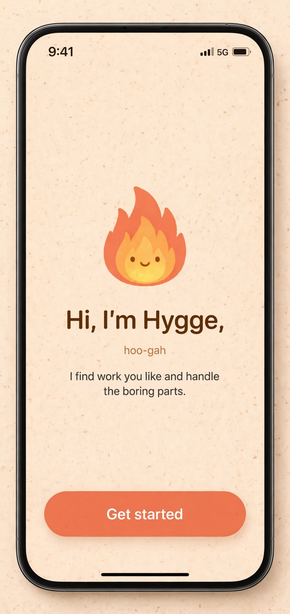
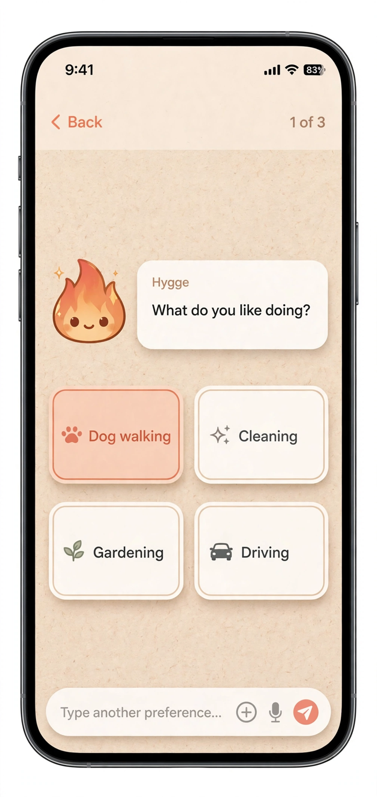
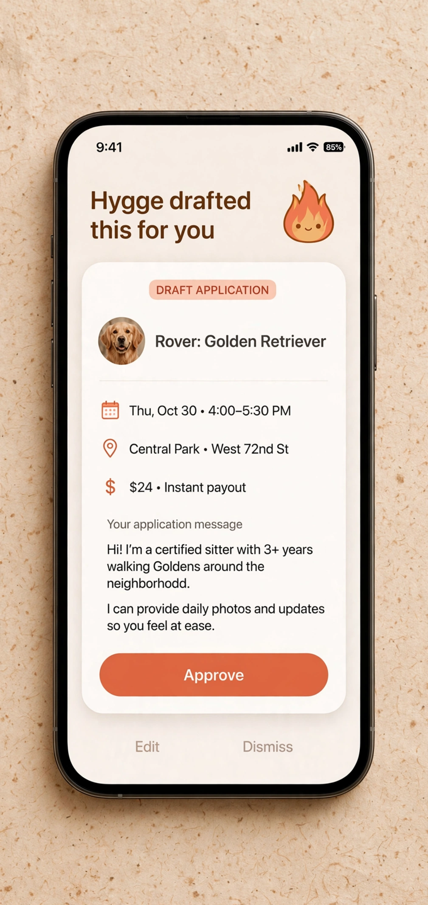
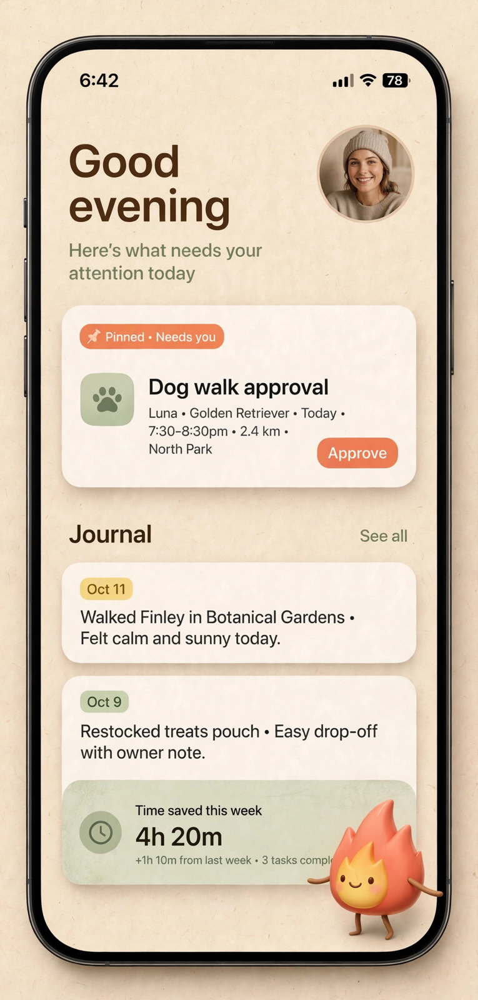
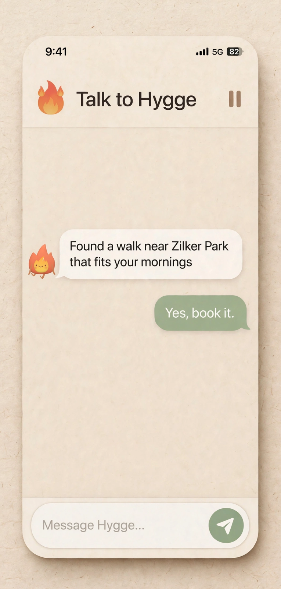
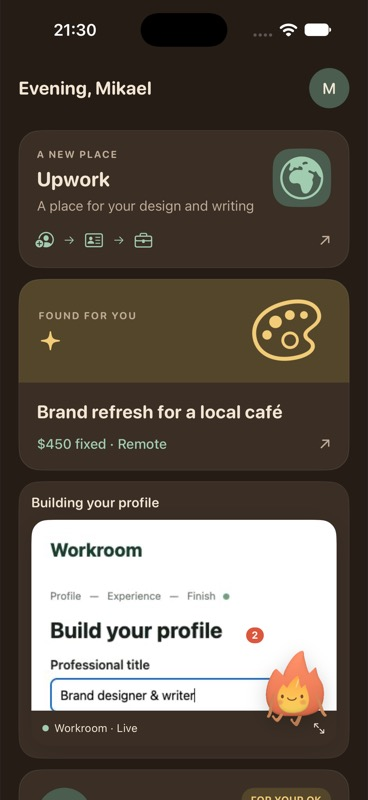
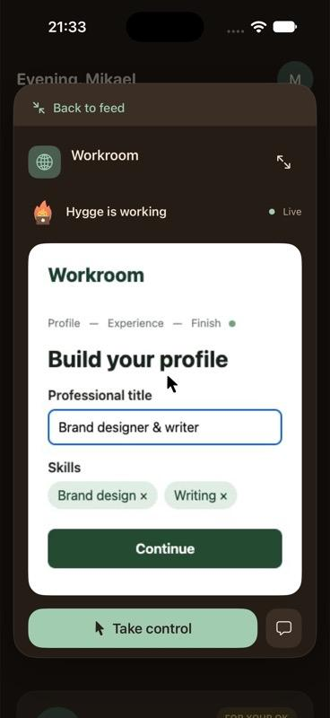
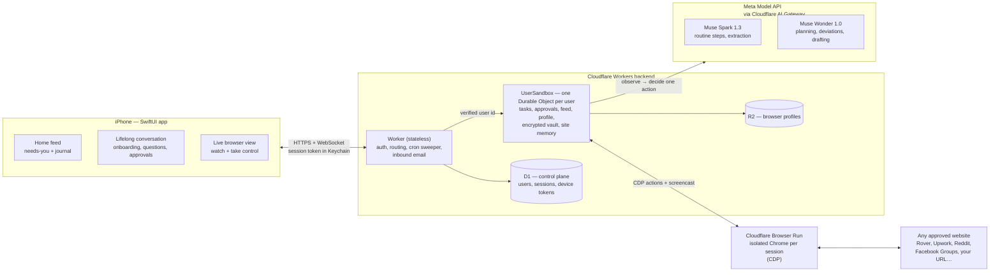
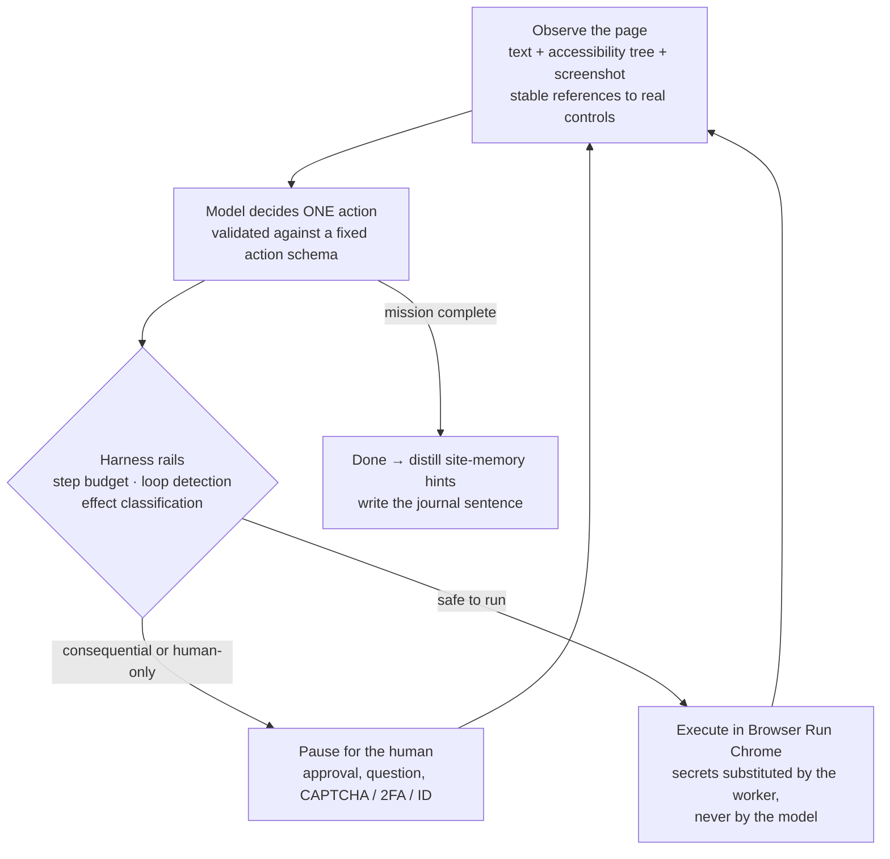

<p align="center">
  
</p>

<h1 align="center">Hygge</h1>

<p align="center"><strong>Work you like, without the boring parts.</strong></p>

<p align="center">
  Hygge (Danish, pronounced “hoo-gah”) means being cozy and spending quality
  time with the people you love. This app gets you more of that — more time for living,
  fewer worries about money — by finding work for you and handling the boring parts of
  managing it. You stay in charge of every decision.
</p>

<p align="center">
  <a href="https://testflight.apple.com/join/VQwBCNSP"><strong>Try the beta on TestFlight</strong></a>
  · <a href="https://usehygge.app">usehygge.app</a>
  · <a href="#run-it-yourself">Run it yourself</a>
  · <a href="#how-it-works-under-the-hood">Architecture</a>
</p>

<p align="center">
  <a href="https://github.com/Lembergdk/hygge/actions/workflows/ci.yml"></a>
  <a href="LICENSE"></a>
  
  
</p>

<p align="center"><em>Built for the Meta Global AI Developer Hackathon — theme: <strong>Build for Your World</strong>. Open source under the <a href="LICENSE">MIT license</a>.</em></p>

---

## In 30 seconds

- **Tell Hygge what work you enjoy** — dog walking, design, tutoring, handyman jobs, writing, almost anything.
- **Hygge looks for it for you** on the websites you approve, using a real browser in the cloud. No site is too small or too obscure, because Hygge browses like a person instead of relying on special integrations.
- **You approve everything.** Sign-ups, applications, messages and bookings are always shown to you first. Nothing is ever sent, posted or booked in your name without your say-so.
- **Hygge keeps up with the rest:** checking your calendar, adding confirmed work to it, drafting replies, and writing down what happened in a plain, honest journal.

**Want to try it?** Join the public beta: [TestFlight — Hygge](https://testflight.apple.com/join/VQwBCNSP) (iPhone, iOS 17 or later). The beta is free.

## The problem

Finding work is itself unpaid work.

Paid opportunities are scattered across dozens of sites, job boards, subreddits and Facebook groups. Nobody has time to watch them all. And finding work is only half of it: managing accounts, filling in profiles, checking calendars, confirming bookings and keeping up messages before and after every gig is a second unpaid job.

Underneath sits a bigger worry — being at the mercy of the next layoff round instead of having some control over your own income.

Hygge watches all of it for you, and only asks for your time when there is something worth deciding.

## What Hygge does for you

### Find work

Hygge builds one earnings profile from your skills and interests, then suggests places where that kind of work is hired. For every place you approve, Hygge can set up your account, help build your profile, and keep looking for work that fits your rate, your area and your time. You can also point Hygge at any website yourself — a local task board, a community group, a page you paste in.

### Handle the boring parts

Hygge does not stop at finding a listing. With your approval it can draft applications and messages, check whether you are free, put confirmed work in your calendar, and keep track of each job from first message to finished work. The work itself is the only part left for you.

### Stay in control

- **One home screen, one decision at a time.** Things that need you are pinned at the top. Everything else becomes a calm journal of what happened, in plain sentences.
- **Watch Hygge work — and take over.** When Hygge is browsing for you, you can watch the real web page live inside the app. If a site asks for something only you can do — a CAPTCHA, a text-message code, an ID check — Hygge stops and hands you the controls. It never tries to sneak past those checks.
- **A Hygge email address of your own.** Hygge can give you a `@usehygge.cc` address to use when signing up for work sites, so verification emails and sign-in codes land where Hygge can help with them. This address can only receive mail. Hygge never sends email as you.
- **Quiet by design.** Hygge only notifies you when something genuinely needs you, or when new matching work has been found. No digests, no nagging, no marketing.
- **Pause any time.** One switch stops all looking and all browsing until you say otherwise.

## A day with Hygge

*An illustrative walkthrough of the intended experience:*

You tell Hygge you love dogs, you are free weekday evenings, and your lowest rate is $20 an hour. Hygge suggests two pet-care sites and a local community board. You approve all three and tap “Create my account” on the first.

Hygge opens the site in its cloud browser and starts signing you up. It needs your phone number for verification, so it asks you in chat — it would never invent one. You answer, handle one text-message code with Hygge's help, and approve the profile Hygge drafted from what you told it.

From then on, Hygge checks your approved sites during the day. That evening it finds a weekend dog-walk that fits your rate and your neighborhood. You get one quiet notification. You read the draft reply Hygge wrote, tweak a word, and tap approve. Hygge sends it, and when the owner confirms, the walk lands in your calendar. Your journal gets one plain sentence about what happened.

## Screenshots

Design direction (product visuals):

| Welcome | Getting to know you | Your approval |
| --- | --- | --- |
|  |  |  |

| Home | Conversation |
| --- | --- |
|  |  |

The app today (real captures from the current build, dark appearance):

| Home feed | Watching Hygge work live |
| --- | --- |
|  |  |

## How it works, step by step

1. **Tell Hygge what you're good at.** Onboarding is a short conversation — what work you enjoy, your lowest rate, roughly where and when. Everything else is learned gradually, and anything Hygge learns about you is shown to you for confirmation, never silently saved.
2. **Approve where Hygge may look.** Hygge proposes sites that fit your interests, each with a short reason. Per site you can say *create my account*, *I already have an account*, or *not this site*. Sites you have not approved are never visited.
3. **Hygge browses like a person.** A cloud browser opens the real website and works toward a clear goal — “get me set up here”, “find walks near me this weekend”. Hygge decides each step from what the page actually shows. There are no per-site scripts to break when a site changes its layout.
4. **Hygge drafts, you approve.** Anything that would change something outside the app — joining a site, publishing a profile, applying, messaging, booking — is drafted first and shown to you with the exact wording. Consequential actions need a fresh, specific yes, every time.
5. **Hygge remembers how sites work.** After a successful visit, Hygge writes down what worked (“listings are readable from the landing page”, “this button is labelled Join now”) as hints for next time. Hints make repeat visits faster. They are advice, never a rigid script — and shared hints only ever contain facts about websites, never anything about you.

## Rules Hygge never breaks

These are enforced in code, not just promised in prompts:

- **Nothing acts in your name without your approval.** Every state-changing task is drafted first and runs only after you approve it. Direct, unapproved runs are refused by the backend.
- **Hygge never invents your information.** If a form needs something Hygge does not know — your phone number, your date of birth — it stops and asks you. It will not guess.
- **Human-only checks stay human.** CAPTCHAs, two-factor codes, ID checks and payment steps pause the work and hand the live browser to you. They are never bypassed or automated around.
- **Your site passwords stay secret.** Logins you save are stored encrypted on the server, under a key that belongs to your account alone. They are typed into login forms by the browser worker and never appear in the app, in logs, or in anything the AI models see. No screen or API can show them back.
- **Honest money and time.** Earnings are counted only from real, witnessed work — never guessed from a listing's pay label. No work yet means “none yet”, not a flattering estimate. Time saved is always “about”, rounded down, with the math visible.
- **Your data stays yours.** Each account gets its own isolated space on the server. Hygge never trains models on your data, and anything Hygge “learns” lives in your space, where it can be inspected and deleted.

## Pricing

The beta is free, and Hygge takes no cut of what you earn.

Planned pricing once the beta ends: free until Hygge helps you earn $100 in a month, then **Plus at $9.99/month or $99/year** for unlimited earnings. The long-term goal is never a slice of every paycheck. It is becoming a trusted part of your personal finances, where partnerships, in-house services, member perks and sponsored opportunities do the rest.

---

## For Meta AI Hackathon judges

- **Theme fit — *Build for Your World*.** Hygge is built for a specific, everyday world: people who could earn more from skills they already have, but lose hours to scattered gig sites and admin. It gives them leverage over their own income without taking decisions away from them.
- **Built during the event.** This repository was created on **Oct 30, 2026**. At the time of writing it holds 140+ commits, all dated inside the Oct 26 – Nov 4 event window. The git history is the receipt.
- **Meta models do the real work.** Every browsing decision, onboarding reply, site suggestion and drafted message comes from Meta's Muse models, routed by phase: **Muse Spark 1.3** (`muse-spark-1.3`) for routine per-step decisions and extraction, escalating to **Muse Wonder 1.0** (`muse-wonder-1.0`) after failures or loops, for high-stakes submits, and for composing user-facing text. Both run in production today — check `curl https://api.usehygge.app/health`, which reports `llm: "live"` and the exact model IDs.
- **It is live, not a demo harness.** Staging (`api-staging.usehygge.app`) and production (`api.usehygge.app`) are both deployed on Cloudflare Workers. The iOS beta is on [TestFlight](https://testflight.apple.com/join/VQwBCNSP). CI runs the Swift and backend test suites on every push and pull request, deploys staging from `main` only after tests pass, and health-checks the result. Production deploys are manual and health-checked the same way.
- **Verified live, not claimed.** On a cold visit to Remote OK, the agent chose its own actions step by step (Spark 1.3, escalating to Wonder 1.0 after a failed click), extracted real job listings, decided it was done, and only then distilled site-memory hints. The observe → decide → act loop is covered by automated tests on both the Swift and TypeScript stacks, including a page-variant test that no canned navigation script could pass. A staging end-to-end script ([e2e-staging.mjs](backend/cloudflare/e2e-staging.mjs)) checks health, auth, two-user isolation, a vault canary that must never leak, the approval gate, live onboarding over SSE, site proposals and a real Browser Run discovery mission.
- **Honest about its edges.** This README — and the docs it links to — say plainly what is live, what is built but deployment-gated, and what is still a foundation. See [Status: what is live vs. still cooking](#status-what-is-live-vs-still-cooking). Sample content in a fresh install is flagged as demo in the data model and disappears as soon as real work arrives; it is never uploaded to the server.

---

## How it works under the hood

The full engineering write-up lives in [docs/ARCHITECTURE.md](docs/ARCHITECTURE.md). The short version:

**There are no per-site API integrations and no navigation scripts — anywhere.** One cloud-browser agent drives any website the user approves, the way a person would: it knows its mission, looks at the page, and decides each action itself. That single decision is what makes “any site, including one you paste in” possible without an integrations team.



### The mission loop

Every unit of work is a **mission**: a goal plus user-approved draft content. The agent runs one loop until the mission is done, paused for the human, or out of budget:



Key properties:

- **One decision per model call**, validated against a fixed action set (`navigate`, `click`, `type`, `select`, `check`, `press`, `hover`, `scroll`, `back`, `forward`, `wait`, `upload`, `extract`, `askUser`, `done`, `needsHuman`). The model finds its own path from what the page shows. See [docs/browser-capabilities.md](docs/browser-capabilities.md).
- **Model routing by stakes.** Spark 1.3 handles routine steps. Wonder 1.0 takes over after failures, deviations and detected loops, for final submits on high-stakes missions (signup, apply, calendar booking), and for drafting user-facing text. Routing, pricing metadata and gateway headers live in [llm.ts](backend/cloudflare/src/llm.ts); the loop itself is [agent.ts](backend/cloudflare/src/agent.ts).
- **Rails in code, not prompts.** Hard step budgets, “same action + target + URL three times” loop detection, and effect classification (`reversible` / `accountCreation` / `public` / `permanent` / `destructive`) run in the harness. Consequential effects require a one-use consent bound to the exact task, session, URL, page labels and draft. A model-supplied “approved” flag cannot authorize anything. See [docs/chat-first-setup.md](docs/chat-first-setup.md).
- **Page content is hostile input.** A listing can contain prompt injection aimed at the user's own agent. Tools stay constrained to the approved goal, anything state-changing needs approval, and secrets exist only as vault placeholders the model cannot exfiltrate.

### Watching and taking over

The app streams the same Chrome page the agent is using. An authenticated WebSocket (`/sessions/:id/stream`) in the user's Durable Object fans one CDP screencast out to all viewers, latest-frame-first, with no frames persisted. “Take control” stops new agent actions, waits for any in-flight action, and hands pointer, scroll, text and keyboard input to the phone over CDP. “Let Hygge continue” validates the attached task and resumes the existing mission — pending approvals are not bypassed by the round trip. See [docs/live-browser.md](docs/live-browser.md).

### Memory that is advice, never a script

After a mission, its trajectory is distilled into per-domain **site-memory hints** with success/failure counts. Future missions receive hints as context they may use or ignore when the page disagrees. A brand-new site always starts from the goal alone.

On top of that sits a per-user **learning model**: every accept, decline (with reason), dismissal and outcome is recorded as a structured feedback event and folded into category/skill affinities and rate/distance sensitivities. One ranker (`rankItem` in [learning.ts](backend/cloudflare/src/learning.ts)) filters and scores both scanned listings and site proposals — below-threshold finds never surface. The ranker's threshold is live server-side today; ranked *ordering* in the feed is wired but not yet user-visible, and the docs say so. See [docs/profile-learning.md](docs/profile-learning.md).

A second, stricter generation of shared “skills” (typed, reviewed, evidence-gated site know-how that can be promoted across users without carrying personal data) exists as a tested foundation. It is **dormant**: gated behind `HYGGE_WORKSPACE_MODE=retained-v2`, with no production activation. See [backend/cloudflare/docs/workspace-skills.md](backend/cloudflare/docs/workspace-skills.md).

### Identity, email and notifications

- **Sign-in** supports Sign in with Apple, email magic links (direct Universal Links into the app, with a hardened browser fallback), and optional email passwords confirmed by a separate emailed link. Sessions are server-issued; the user ID always comes from the verified credential, never from request data. See [docs/magic-link-handoff.md](docs/magic-link-handoff.md) and [docs/password-confirmation-flow.md](docs/password-confirmation-flow.md). Onboarding deliberately runs *before* sign-up through two stateless, rate-limited preview routes — sign-in is the last onboarding step.
- **Your Hygge email address** (`@usehygge.cc`, receive-only) is delivered by Cloudflare Email Routing into the owning user's sandbox. Mail is classified as verification / security code / other; codes are sealed and only ever shown as “a code arrived”, never in push payloads or logs. Sender-attributed actions require aligned DKIM/SPF/DMARC. A backend test asserts that no mail-send path exists at all. See [docs/email-usehygge-cc.md](docs/email-usehygge-cc.md).
- **Scheduled scanning** runs the same discovery missions unattended: approved sites with a saved login are checked up to three times a day (07:00 / 13:00 / 19:00 UTC), public-only sites once a day, nothing at all while the user is paused. A strict surfacing gate (category, skills, place, rate floor, dedupe) decides what reaches the feed, quiet categories rest for a month, and a scan can never send, book or apply for anything. See [docs/scheduled-scanning.md](docs/scheduled-scanning.md).
- **Push is transactional only**: a task needs you, or a scan found new work. At most one push per scan tick, a bare title with no body (so nothing sensitive *can* ride along), and every attempt logged without tokens or payload contents. See [docs/push-notifications.md](docs/push-notifications.md).
- **Profile photos** are stored privately per account (re-encoded, metadata-stripped, size-capped). The agent only ever learns `hasProfilePhoto`; the actual file is attached inside the worker, only for approved signup/profile tasks on the approved HTTPS host. See [docs/profile-photos.md](docs/profile-photos.md).

### Multi-tenancy and privacy invariants

All users share the same model weights through stateless API calls. Hygge never fine-tunes on user data. Everything an agent appears to remember is Hygge state, isolated like this:

1. **One Durable Object per user.** The object name *is* the isolation boundary: one user ID, one sandbox, one vault, one site memory. Prompts are assembled only from that user's profile, tasks and page snapshots.
2. **Per-user encryption keys.** Credentials are AES-256-GCM encrypted under a per-user data key wrapped by the environment master key. Deleting the data key crypto-shreds that user's secrets.
3. **Tenancy on every record.** Tasks, memory, applications and object keys carry `user_id`; cross-user isolation is covered by tests and by the staging end-to-end script.
4. **Shared memory carries no personal data.** Promoted site hints contain only facts about websites. Values, page text and names are scrubbed before promotion and never cross tenants.
5. **Standard model IDs only** (never `-contributor` variants). In production, AI Gateway payload collection and trace payloads are off — metadata and usage only; staging records payloads for debugging.

### Observability and cost

LLM traffic runs through Cloudflare AI Gateway with a custom Meta provider: the Meta key stays in the gateway's stored keys (BYOK), so workers send a scoped gateway token instead of a provider `Authorization` header. Because the gateway has no built-in pricing for a custom provider, each request carries per-token custom-cost headers from Meta's published list prices, so gateway analytics price every call from real token usage. Agent tracing emits `invoke_agent` / `chat` / `execute_tool` GenAI spans with usage data ([tracing.ts](backend/cloudflare/src/tracing.ts)).

### Tech stack

| Layer | What runs it |
| --- | --- |
| iOS app | SwiftUI (iOS 17+), in [App/](App/). Warm Nordic design system, one home feed, no tab bar. |
| Shared core logic | Swift package [`HyggeCore`](Sources/HyggeCore/) — models, onboarding script, matching display logic, backend contracts. Unit-tested without a simulator. |
| Backend | TypeScript on Cloudflare Workers, in [backend/cloudflare/](backend/cloudflare/). One worker per environment. |
| Per-user state | `UserSandbox` Durable Object (SQLite storage) per verified user: tasks, approvals, feed, profile, vault, site memory, learning model. |
| Control plane | D1 (users, sessions, device tokens, email addresses, shared-skill tables). Migrations `0001`–`0008` in [backend/cloudflare/migrations/](backend/cloudflare/migrations/). |
| Browser | Cloudflare Browser Run (isolated Chrome per session) driven over CDP via `@cloudflare/puppeteer`, plus R2 for browser-profile storage. A deterministic simulated decider runs the same loop with no API key, and `/health` says so (`llm: "simulated"`). |
| Models | Meta `muse-spark-1.3` + `muse-wonder-1.0`, via Cloudflare AI Gateway (custom provider, BYOK) or directly against `https://api.meta.ai/v1`. |
| Email in | Cloudflare Email Routing (catch-all) into the worker. Email out: magic-link mail only, from one pinned sender. |
| Push | APNs from the worker (token lifecycle in D1, every attempt logged). |
| Delivery | GitHub Actions: tests on every push/PR, staging auto-deploy from `main`, production on manual dispatch, TestFlight on manual dispatch. See [.github/workflows/](.github/workflows/). |

### Status: what is live vs. still cooking

| Area | Status |
| --- | --- |
| iOS beta (TestFlight), staging + production APIs | **Live.** `/health` reports the live models on both. |
| Conversational onboarding, site proposals, approvals, missions, vault, site memory, live browser + takeover, calendar booking after approval | **Live** in the current build. |
| Sign in with Apple, magic links, optional passwords | **Live.** Universal Links verified against origin and Apple CDN records. |
| Scheduled scanning (3×/day) | **Built and configured** (cron triggers committed in both wrangler configs; the sweeper runs the same mission path as manual discovery). Per-user ticks are testable without a deployed clock. |
| `@usehygge.cc` receive-only email | **Pipeline built; DNS live** (MX records resolve to Cloudflare Email Routing). First live delivery checks are documented in [docs/email-usehygge-cc.md](docs/email-usehygge-cc.md). |
| Push notifications | **Pipeline built.** Sends only when an APNs key is configured; otherwise each event is logged as an honest `unconfigured` no-op, never a fake success. |
| Profile learning / ranking | **Threshold live server-side;** ranked feed ordering is wired but not yet user-visible. |
| Retained-workspace V2 + shared skills V2 | **Dormant foundation.** Tested code, no production activation (`HYGGE_WORKSPACE_MODE` stays unset). |
| Fresh-install sample content | **Labelled demo data** (`isDemo`), local only, never uploaded, hidden as soon as real work arrives. |

---

## Run it yourself

Hygge is open source (MIT). There are four ways in, from easiest to full self-hosting. The original local Node agent service has been retired — the Cloudflare Worker is the only backend, and release builds of the app require it.

### Option A — just try the app (no code)

Join the public beta on TestFlight: [testflight.apple.com/join/VQwBCNSP](https://testflight.apple.com/join/VQwBCNSP) (iPhone, iOS 17+). It talks to the live production backend.

### Option B — run the iOS app from source

You need a Mac with a recent Xcode (the deployment target is iOS 17; TestFlight uploads require the latest stable Xcode).

```bash
git clone https://github.com/Lembergdk/hygge.git
cd hygge
open Hygge.xcodeproj   # scheme "Hygge", run on an iOS 17+ simulator or device
```

Or build from the command line, unsigned, exactly as CI does:

```bash
xcodebuild -project Hygge.xcodeproj -scheme Hygge \
  -destination 'generic/platform=iOS Simulator' \
  CODE_SIGNING_ALLOWED=NO build
```

Which backend you get: **Debug → staging** (`api-staging.usehygge.app`), **Release → production** (`api.usehygge.app`), and an HTTPS developer override in settings wins over both ([BackendClient.swift](App/BackendClient.swift)). Release builds refuse to fall back to on-device simulation (`HYGGE_REQUIRE_CLOUD`); Debug builds may use the local simulated runner and say so in the task log.

Running on a physical device with your own Apple team? Change the bundle ID (`app.usehygge`) and team in Xcode — capabilities used are Sign in with Apple, Push Notifications and Associated Domains (see the entitlement files in [App/](App/)).

### Option C — run the backend locally

You need Node 22 (as in CI) and, for the local dev server, Docker running (the per-user sandbox uses a local container). The backend runs on any OS.

```bash
cd backend/cloudflare
npm ci
npm test                          # unit/integration suite (40 test files, 365 tests)
./node_modules/.bin/tsc --noEmit  # type-check
npm run dev                       # wrangler dev with the staging config
```

`npm run dev` starts a local Worker (by default at `http://localhost:8787`). Check it with `curl http://localhost:8787/health`.

> **Local wrangler gotcha (checked Nov 3, 2026):** the lockfile's wrangler (4.156) bundles a local runtime that tops out at compatibility date `2026-10-30`, while the committed configs request `2026-10-31` — so `npm run dev` currently fails locally with “requires compatibility date 2026-10-31”. Deployed workers are unaffected. Until the lockfile moves, run the dev server with a local-only override (do not edit the committed date to deploy):
>
> ```bash
> npx wrangler dev -c wrangler.staging.jsonc --local --compatibility-date 2026-10-30
> # then: curl http://localhost:8787/health  →  {"ok":true, … "llm":"simulated", …}
> ```

**With no API key**, the mission loop still runs end-to-end on a deterministic simulated decider, and `/health` reports `llm: "simulated"` — handy for exploring the contracts offline. **To use the real models**, create a `.dev.vars` file next to the wrangler config (never commit it) with at minimum:

```ini
HYGGE_LLM_API_KEY="<your Meta Model API key>"
HYGGE_MASTER_KEY="<base64-encoded 32 random bytes>"
```

and point `HYGGE_LLM_BASE_URL` at `https://api.meta.ai/v1` for direct calls (the committed configs point at the author's AI Gateway instead — see [Configuration reference](#configuration-reference)).

Browser-capability tests run against real Chrome when available:

```bash
npm run test:browser
```

Local live-browser fixtures (loopback only) are documented in [docs/live-browser.md](docs/live-browser.md#local-reproduction).

### Option D — deploy your own Hygge on Cloudflare

You need a Cloudflare account with Workers, D1, R2, Browser Run and (optionally) AI Gateway, Email Routing and a custom domain. The committed wrangler configs reference the author's account resources and domains — create your own and update the IDs, bucket names, routes and vars in your copy. Always pass the config explicitly (`-c …`); separate config files per environment are deliberate (with wrangler `env`, the container application does not bind to the right Durable Object namespace).

First-time provisioning for an environment (staging shown; production is the same shape):

```bash
cd backend/cloudflare
npm ci
npx wrangler login
npx wrangler d1 create hygge-staging        # paste the returned id into wrangler.staging.jsonc
npx wrangler r2 bucket create hygge-browser-profiles-staging
npx wrangler d1 migrations apply hygge-staging --remote -c wrangler.staging.jsonc
npx wrangler secret put HYGGE_LLM_API_KEY -c wrangler.staging.jsonc   # direct mode
npx wrangler secret put HYGGE_MASTER_KEY -c wrangler.staging.jsonc    # base64, 32 bytes
npx wrangler secret put HYGGE_DEV_TOKENS -c wrangler.staging.jsonc    # staging-only dev auth: {"<token>":"<userId>"}
npx wrangler deploy -c wrangler.staging.jsonc   # run twice on the very first deploy (container app)
curl https://<your-staging-domain>/health
```

Then point a Debug build of the app at your worker via the HTTPS backend override in settings, and use a `HYGGE_DEV_TOKENS` token (staging) or real sign-in (Apple / magic link) to create your first account. Optional extras each need their own setup and fail safe without it: APNs push (`HYGGE_APNS_*` secrets), `@usehygge.cc`-style inbound email (Email Routing catch-all → your worker), and the AI Gateway route (store the Meta key in the gateway, set `HYGGE_AIG_TOKEN`, and gateway/trace payload logging stays off unless you turn it on for debugging).

> ⚠️ **Before exposing your deployment to anyone else:** Hygge stores third-party site passwords so the agent can sign in within approved tasks. That makes your deployment a high-value target. Use a unique `HYGGE_MASTER_KEY` per environment, keep secrets in wrangler secrets (never in config files), and read the hardening notes in [docs/ARCHITECTURE.md](docs/ARCHITECTURE.md). The author's staging/production endpoints are for the official beta — please run your own for experiments.

### Run the tests

```bash
# Swift core logic (no simulator needed)
swift test --disable-sandbox

# Backend
cd backend/cloudflare && npm ci && ./node_modules/.bin/tsc --noEmit && npm test

# Extra checks CI enforces
node scripts/check-user-copy.mjs        # no developer vocabulary in user-facing copy
python3 scripts/check-flame-assets.py   # flame assets stay full-frame APNGs
python3 scripts/test-release-app-links.py
```

### Configuration reference

Plain vars live in the `vars` block of each wrangler config; everything sensitive is a wrangler secret (`wrangler secret put …`, or `.dev.vars` locally — never committed).

| Setting | Where | Purpose |
| --- | --- | --- |
| `HYGGE_ENV` | var | `staging` / `production`. Gates staging-only behaviors (e.g. dev tokens). |
| `HYGGE_LLM_BASE_URL` | var | Model endpoint. Direct: `https://api.meta.ai/v1`. Or your AI Gateway URL. |
| `HYGGE_LLM_MODEL_FAST` / `HYGGE_LLM_MODEL_STRONG` | var | Model IDs. Default `muse-spark-1.3` / `muse-wonder-1.0`. |
| `HYGGE_LLM_API_KEY` | secret | Meta Model API key (direct mode). Absent → simulated decider. |
| `HYGGE_AIG_TOKEN` | secret | AI Gateway Run token (gateway mode; provider key stays in gateway BYOK storage). |
| `HYGGE_AIG_COLLECT_PAYLOAD` | var | `1` lets the gateway store raw prompt/response bodies (author's staging only; production is `0`). |
| `HYGGE_TRACE_PAYLOADS` | var | `1` records prompt/reply payloads on tracing spans (staging only; production is `0`). |
| `HYGGE_MASTER_KEY` | secret | Base64, 32 bytes. Wraps every per-user vault key. Unique per environment. |
| `HYGGE_DEV_TOKENS` | secret | Staging-only JSON map of bearer token → user ID for development and e2e tests. Never used in production. |
| `HYGGE_APPLE_BUNDLE_ID` | var | Expected audience for Sign in with Apple tokens (`app.usehygge`). |
| `HYGGE_MAGIC_BASE_URL` | var | Public API origin that magic links point at. |
| `HYGGE_EMAIL_DOMAIN` | var | Receive-only address domain (`usehygge.cc`). |
| `HYGGE_APNS_KEY_P8` / `HYGGE_APNS_KEY_ID` / `HYGGE_APNS_TEAM_ID` | secret | APNs signing material. Unset → push is a logged no-op. |
| `HYGGE_APNS_ENVIRONMENT` | var | `sandbox` (Debug builds) or `production` (Release builds). |
| `HYGGE_WORKSPACE_MODE` | var (unset) | Leave unset. `retained-v2` enables the dormant workspace/skills foundation — not production-activated. |

iOS build settings that matter: `HYGGE_REQUIRE_CLOUD` (`NO` in Debug, `YES` in Release) and the bundle ID `app.usehygge`.

---

## Repo map

| Path | What's there |
| --- | --- |
| [App/](App/) | iOS app: SwiftUI views (feed, conversation, approvals, live browser, settings), services (backend client, calendar, permissions, push), flame assets. |
| [Sources/HyggeCore/](Sources/HyggeCore/) | Platform-independent core: models, onboarding script, agent-task contracts, matching display logic, push routing, seed sites. |
| [Tests/HyggeCoreTests/](Tests/HyggeCoreTests/) | Core unit tests (91 test cases across 9 files). |
| [backend/cloudflare/](backend/cloudflare/) | The backend: Worker + `UserSandbox`, agent loop, auth, vault, email, scanning, learning, push, tracing. Start at [backend/cloudflare/README.md](backend/cloudflare/README.md). |
| [backend/cloudflare/src/](backend/cloudflare/src/) | Backend source. `index.ts` routes, `user-sandbox.ts` is the per-user system of record, `agent.ts` + `llm.ts` + `browser*.ts` run missions. |
| [backend/cloudflare/migrations/](backend/cloudflare/migrations/) | D1 migrations `0001`–`0008` (init, auth, skills, email, web access, magic links, password confirmations, shared skills V2). |
| [backend/cloudflare/test/](backend/cloudflare/test/) | Backend tests, including real-SQLite migration tests and isolated-Chrome browser tests. |
| [backend/cloudflare/container/](backend/cloudflare/container/) | Retained-container image for the dormant workspace V2. Not needed for the live product. |
| [docs/](docs/) | Architecture and feature docs: [ARCHITECTURE.md](docs/ARCHITECTURE.md), [live-browser.md](docs/live-browser.md), [scheduled-scanning.md](docs/scheduled-scanning.md), [profile-learning.md](docs/profile-learning.md), [push-notifications.md](docs/push-notifications.md), [email-usehygge-cc.md](docs/email-usehygge-cc.md), [chat-first-setup.md](docs/chat-first-setup.md), [browser-capabilities.md](docs/browser-capabilities.md), and more. |
| [docs/design/](docs/design/) | Design atoms (SVG component specs + tokens) and the approved flame character source. |
| [docs/screenshots/](docs/screenshots/) | Product visuals used in this README, plus the flame mark. |
| [outputs/feed-redesign/](outputs/feed-redesign/) | Native QA captures of the current feed (also used above). See [design-qa.md](design-qa.md). |
| [scripts/](scripts/) | Asset and guard-rail scripts (flame assets, user-copy check, release app-link checks). |
| [.github/workflows/](.github/workflows/) | CI (tests + staging/production deploys) and the manual TestFlight workflow. |

## How Hygge is delivered

- **CI** ([ci.yml](.github/workflows/ci.yml)) runs on every push to `main` and every pull request: Swift core tests, copy/asset/app-link checks, an unsigned iOS simulator build, backend type-check + tests, a `wrangler deploy --dry-run` bundle, and browser-capability tests in isolated Chrome.
- **Staging** deploys automatically from `main` after tests pass, followed by a `/health` check. **Production** deploys only on manual workflow dispatch, health-checked the same way.
- **TestFlight** ([testflight.yml](.github/workflows/testflight.yml)) is manual-dispatch: it archives with the newest Xcode, verifies the signed IPA actually carries the Associated Domains / Push / Sign in with Apple capabilities, and only then uploads.

## Known limits and honest edges

- **Site reliability varies.** Some sites prohibit automated access in their terms and actively detect bots. Hygge never bypasses human checks, so expect per-site reliability to differ. Use Hygge only on sites and accounts where you are allowed to do so, and respect each site's terms.
- **Ranked ordering isn't visible yet.** The learning ranker filters what surfaces (threshold), but the feed does not yet order by score. The ready-made ordering ships with the feed consumer work.
- **Scan sweep is sequential.** One cron invocation walks users one at a time (rotating the start for fairness). Sharding or per-user alarms is the documented follow-up if the fleet grows. Scan times are fixed UTC slots for now.
- **Long missions are request-driven.** There is no durable background job queue guaranteeing execution across process termination; recovery and checkpoints are built around that reality.
- **Local Chrome ≠ Browser Run acceptance.** Browser tests verify the CDP protocol locally; deployed-session behavior is validated on staging. Live third-party login/CAPTCHA flows still need device acceptance per site.
- **Architecture doc lag.** [docs/ARCHITECTURE.md](docs/ARCHITECTURE.md) describes the model correctly but still shows the retired local Node service in its diagram. This README reflects the current Cloudflare-only backend; the doc update is tracked with the code.

## Contributing

Issues and pull requests are welcome. Hygge is a small, opinionated codebase, so:

1. Open an issue first for anything bigger than a fix, so we can agree on shape before code.
2. Keep the invariants: draft → approve → run, never invent user data, secrets never reach prompts/logs/responses, human-only checks stay human. A change that weakens one of these will not be merged, however convenient.
3. Run the checks CI runs (`swift test --disable-sandbox`, backend `tsc --noEmit` + `npm test`, `node scripts/check-user-copy.mjs`) and say in the PR what you observed.
4. User-facing copy avoids developer vocabulary — the copy check will tell you.

## License

[MIT](LICENSE) © Mikael Lemberg. Use it, fork it, learn from it — a link back is appreciated but not required.

Built with Meta's Muse models (Spark 1.3 and Wonder 1.0) on Cloudflare Workers, Browser Run, Durable Objects, D1 and R2. The walking flame is Hygge. Say it with us: *hoo-gah*.
