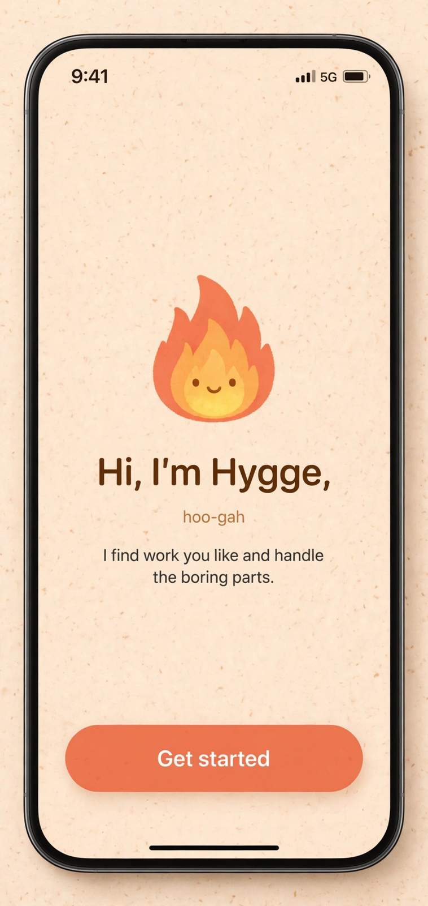
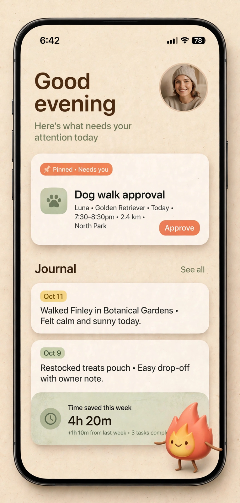
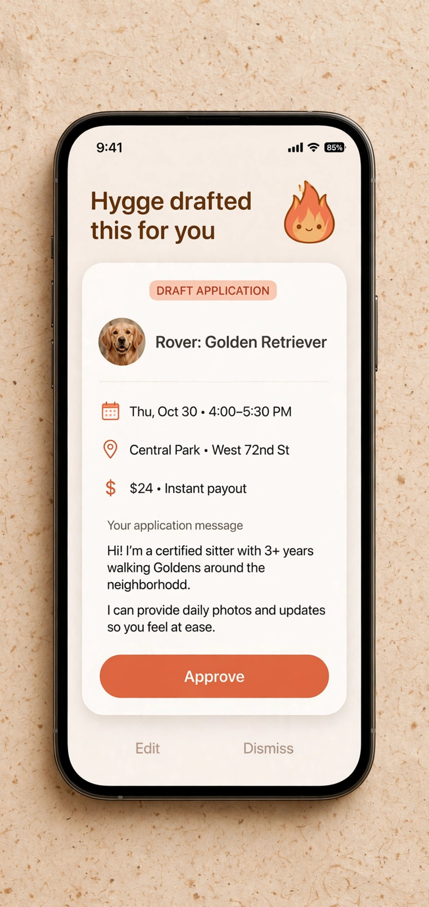
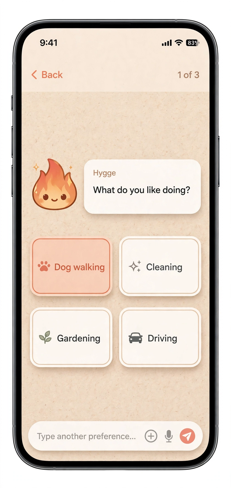
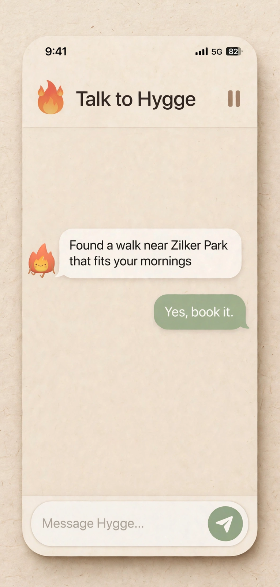

<p align="center">
  
</p>

<h1 align="center">Hygge</h1>

<p align="center"><strong>Work you like, without the boring parts.</strong></p>

<p align="center">Hygge (Danish, pronounced "hoo-gah") is being cozy and spending quality time with the people you love. This app gets you more of that — more money, fewer worries — by doing the boring work of finding it and managing it.</p>

<p align="center"><a href="https://usehygge.app">usehygge.app</a> · Built for the Meta Global AI Developer Hackathon — theme: <em>Build for Your World</em></p>

## The problem

Finding work is itself unpaid work. Gig opportunities are scattered across dozens of sites, boards, subreddits, and Facebook groups, and nobody has time to watch them all — and even when you find work, managing it is a second unpaid job: juggling accounts, checking your calendar, confirming bookings, and keeping up communication before and after every gig.

Hygge watches all of it for you, and only asks for your time when there's something worth deciding.

## What Hygge does

**Find work.** Hygge builds one earnings profile from your skills and interests, then finds work that fits: tailored job applications, freelancer and gig-site signup with profile management and proposals, and scans of boards, subreddits, and Facebook groups for paid opportunities — so you never miss a beat.

**Manage it end-to-end.** Hygge doesn't stop at finding the job. It manages your accounts and each job from start to finish: checking your calendar for availability, adding confirmed bookings to your calendar, and handling communication before and after gigs.

**One approval queue.** Everything Hygge finds and drafts lands in a single queue, and nothing ever acts in your name without your approval.

## Screenshots

| Welcome | Home feed | Approval |
|---|---|---|
|  |  |  |

| Onboarding | Conversation |
|---|---|
|  |  |

## How it works

1. **Tell Hygge what you're good at.** A conversational onboarding builds your earnings profile from your skills and interests — personalized replies, free-text extraction, tailored suggestions.
2. **Hygge scans the sites you approve.** A cloud browser agent works on *any* website you point it at — pet-sitting sites, Upwork, Reddit, Facebook groups, local task boards, or a URL you paste in. No per-site APIs, integrations, or scripts: the agent starts each mission from its goal, looks at the page, and decides every action itself.
3. **Hygge draft, you approve.** Every task is drafted first (goal, site, exact text), and nothing runs until you tap approve. Afterwards each run is distilled into advisory site memory — hints that make future visits faster, never replayed as a script.
4. **Hygge runs the job end-to-end.** Once you approve, Hygge checks your calendar for availability, adds the confirmed booking to your calendar, and handles the communication around the gig — before and after — so the work itself is the only part left for you.

## For judges

- **Built during the event.** This repository was created Oct 30, 2026, and every commit falls inside the Oct 26 – Nov 4 event window.
- **Meta models doing real work.** The cloud-browser agent runs on Meta's Muse models, routed per phase: Spark 1.3 for routine steps and extraction, Wonder 1.0 for planning, deviations, and drafting.
- **Verified live, not claimed.** On a cold visit to Remote OK (run on the original local service, since retired — the cloud port has since reached parity), the agent chose its own actions step by step (Spark 1.3, escalating to Wonder 1.0 after a failed click), extracted real job listings, decided it was done, and only then distilled site-memory hints. The mission loop (observe → decide → act) is tested on both stacks, including a page-variant test no canned script could pass.
- **Rules the app never breaks.** It never invents data: when required information is unknown, a signup mission asks you instead of guessing. Nothing runs without your approval. Site passwords live encrypted in the server-side vault and are filled into login forms by the browser worker — never shown in the app, logs, or prompts. CAPTCHA, 2FA, and ID checks hand over to a human — never bypassed.

## What it can do today

Conversational onboarding with email, location, calendar, and notification permissions; site proposals with per-site approval and account tracking; signup missions that ask instead of inventing; matching; any-URL sites; goal-based missions with edit-and-approve; the LLM mission loop; live discoveries entering the feed as real items; site-memory distillation; encrypted credential vault with redacted injection; interactive cloud-browser view with takeover; applications pipeline; calendar booking; calendar availability checks; client communication drafted in the approval flow. Cloudflare Workers backend: per-user Durable Object sandboxes with encrypted vault and site memory — staging and production both live (api-staging.usehygge.app, api.usehygge.app). Release builds require the cloud backend; Debug defaults to staging, Release to production.

Still to build: deduped click-through extraction into feed items (the feed still ships labelled demo items). See `docs/ARCHITECTURE.md`.

## Pricing

Free until Hygge makes you $100 in a month — then Plus at $9.99/month or $99/year for unlimited earnings. The goal is never a cut of every paycheck: it's becoming embedded in your personal finances, where partnerships, in-house services, member perks, and sponsored opportunities do the rest.

## Tech

- **iOS app:** SwiftUI, iOS 17+
- **Backend:** Cloudflare Workers (TypeScript) — cloud browser, site memory, credential vault; per-user Durable Objects, D1, R2 — staging `api-staging.usehygge.app`, production `api.usehygge.app`
- **Browser:** Cloudflare Browser Run (isolated Chrome per session), with a deterministic simulated browser so the whole product works offline in development
- **Tests:** `swift test` (HyggeCoreTests); backend `npm test` + `tsc --noEmit`
- **Delivery:** CI runs core + backend tests on every push and pull request, deploys staging from main after tests pass (with a /health check), and deploys production only on manual workflow dispatch (also health-checked).

## Run it

**iOS app** — open `Hygge.xcodeproj`, run on an iOS 17+ simulator or device.

```bash
xcodebuild -project Hygge.xcodeproj -scheme Hygge -destination 'generic/platform=iOS Simulator' CODE_SIGNING_ALLOWED=NO build
```

The browser is driven by an LLM agent, one per user: **muse-spark-1.3** for routine steps/extraction, **muse-wonder-1.0** for planning, deviations, and drafting. Point it at a live endpoint with the `HYGGE_LLM_*` Worker settings; without a key a labelled simulated decider runs the same loop.

**Agent service** (cloud browser, site memory, credential vault) — lives in `backend/cloudflare` (Worker + per-user sandbox). Staging: https://api-staging.usehygge.app, production: https://api.usehygge.app. See `backend/cloudflare/README.md`. The original local Node service was retired once the cloud port reached parity (in git history).

Release builds require the cloud backend (`HYGGE_REQUIRE_CLOUD`); Debug builds default to staging, Release builds to production, and a developer override still wins.

**Core logic tests** — `swift test`

## Repo map

- `App/` — iOS app (SwiftUI views, flame assets)
- `backend/cloudflare/` — Cloudflare Workers backend (staging + production)
- `Tests/` — HyggeCoreTests
- `docs/` — architecture notes and design atoms
- `scripts/` — asset and dev scripts
